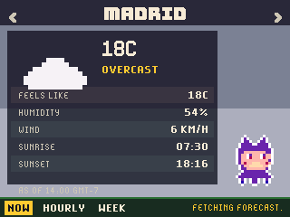
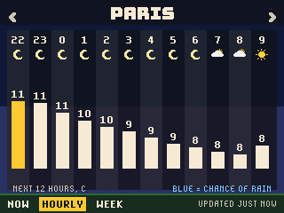
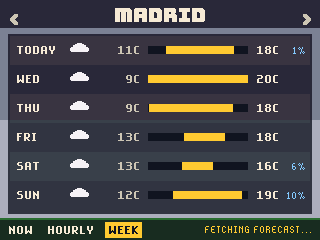
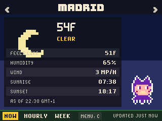

# Mona Weather for the GitHub Universe 2026 badge

An 8-bit weather app for the GitHub Universe 2026 badge: the forecast where you are or in two dozen cities, from Open-Meteo, with Mona dressed for the conditions.

| Now | Hourly | Week | Fahrenheit |
| --- | --- | --- | --- |
|  |  |  |  |

Mona is drawn the way the badge's own apps draw her: white outline, purple
fur, peach face, two-pixel eyes and tentacles.

## Install

1. Put the badge in USB Disk Mode (open the Mass Storage app, or double-tap
   RESET) so the `BADGER` volume appears.
2. Copy the `apps/mona_weather` folder into `BADGER/apps/` (so you end up with
   `BADGER/apps/mona_weather/__init__.py`).
3. If your badge still runs the stock event menu, its tiles ignore `icon.png`.
   The [hyb26 skill](https://github.com/badger/home/tree/main/.github/skills/hyb26-skill)
   ships `patch_menu_icons.py`, which adds that support (with a backup).
4. Eject the volume. The badge restarts into the menu with a Mona Weather tile.

Needs Wi-Fi: put the network name and password in the badge's `secrets.py` (`WIFI_SSID` and `WIFI_PASSWORD`), for example through the Settings app. The city and unit choice are saved under `/state`.

## Controls

| Button | Action |
| --- | --- |
| Left / Right | Change city: "Here" first, then 23 cities around the world |
| Up / Down | Now, Hourly or Week |
| Select | Fetch again now |
| Menu | Switch between Celsius and Fahrenheit; the footer chip names the unit it switches to, and the forecast is refetched in the new unit |

## How it works

- Forecasts come from the keyless Open-Meteo API: current conditions, twelve hourly steps with rain chances, and six days of highs, lows and sunrise and sunset, all in the location's own time zone. The reply is about 2KB and is streamed to a file by the firmware fetch, one step a frame.
- "Here" asks ip-api.com for the badge's approximate position from its internet address, and remembers it. Units default to Fahrenheit when the badge's `REGION` is `us`.
- WMO weather codes map to ten pixel icons and sky colours (day and night variants), the Now page animates rain or snow, and Mona wears sunglasses under a clear sky and carries an umbrella in the rain. The last forecast for each city is kept so the app still shows something offline.

The sprites are drawn from pixel maps by `tools/build_sprites.py`
(`python3 tools/build_sprites.py weather apps/mona_weather/assets`).

## Tools

- `tools/build_sprites.py` regenerates the sprite sheets.
- `tools/badge_harness.py` (with `tools/badge_kit.py` copied to `/state/kit.py`
  on the badge) drives the app's frame loop on a real badge over `mpremote
  run`, simulating button presses and saving run-length encoded screenshots
  to `/state/shots`; `tools/rle2png.py` converts them.

Mona is GitHub's Octocat mascot; this is a fan project and not affiliated
with GitHub.
